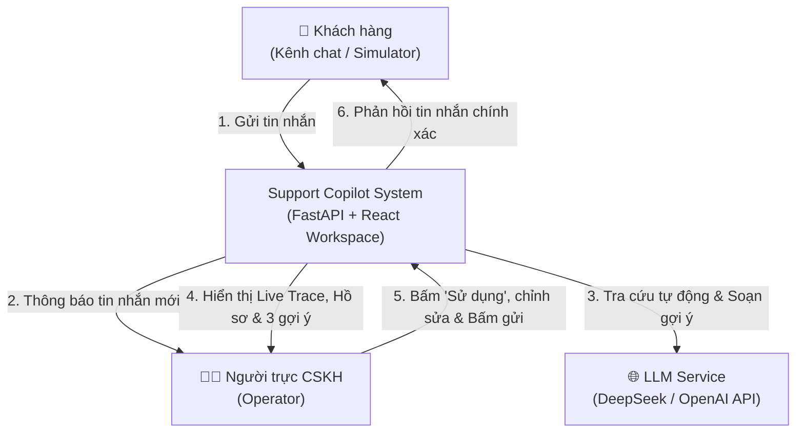
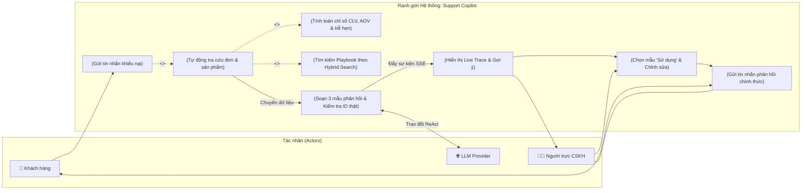

# 01 - System Context & Boundary

> **Status:** Active (Synchronized with Release 1 PRD)  
> **Layer:** Architecture Layer  
> **Scope:** Biên giới hệ thống Copilot Support, các tác nhân (Actors), sơ đồ Use Case ranh giới phạm vi nghiệp vụ  

---

## 1. Actors & External Entities
- **Khách hàng (Customer / Shopper Simulator):** Gửi tin nhắn thắc mắc/khiếu nại qua kênh chat của shop "Nhà Gọn".
- **Người trực CSKH (Support Operator):** Nhận tin nhắn, xem tiến trình suy luận và gợi ý của Copilot, bấm "Sử dụng", tinh chỉnh nội dung và bấm gửi.
- **LLM Provider (DeepSeek / OpenAI API):** Dịch vụ LLM đám mây xử lý các vòng suy luận ReAct, sinh câu trả lời theo khuôn mẫu JSON và tạo vector embeddings.

---

## 2. System Context Diagram (C4 Level 1)

---

## 3. Sơ đồ Use Case Ranh giới Hệ thống (Use Case Boundary Diagram)

Được đồng bộ trực tiếp từ bản đặc tả nghiệp vụ [docs/implementation/release-1/prd.md](../implementation/release-1/prd.md):

---

## 4. Boundary Invariants (Quy tắc Ranh giới Bất biến)
1. **Khách hàng không bao giờ được kết nối trực tiếp với LLM:** Toàn bộ phản hồi gửi đến khách hàng bắt buộc phải qua sự xác nhận của Người trực (Human in the loop).
2. **Cổng giao tiếp LLM kiểm soát Token:** Mọi tương tác với LLM Provider đều phải đi qua module `Meter` để kiểm soát độ dài context, giới hạn tối đa 6 vòng lặp và đo lường chi phí.
3. **Data Invariant:** Hệ thống chỉ được đọc dữ liệu từ 4 bảng JSON và SQLite Embeddings; Agent không có quyền sửa/xóa dữ liệu gốc.
