# 02 - High-Level Architecture

> **Status:** Draft  
> **Layer:** Architecture Layer  
> **Scope:** Kiến trúc tổng thể và các luồng tương tác chính giữa các thành phần  

---

## 1. High-Level Component Topology

```mermaid
flowchart LR
    subgraph Frontend["Frontend SPA (React + TypeScript)"]
        CustomerView["Khách hàng Chat Simulator"]
        OperatorView["Bàn làm việc Người trực"]
        CopilotPanel["Cột Copilot (Trace & Gợi ý)"]
    end

    subgraph Backend["Backend API (Python FastAPI)"]
        APIRouter["API Router / SSE Endpoint"]
        AssistService["Assist Service (Single Call)"]
        AgentEngine["ReAct Agent Engine (Multi-turn)"]
        HybridRetriever["Hybrid Retriever (0.3 BM25 + 0.7 Vector)"]
        StatsEngine["Customer Stats Engine (Deterministic)"]
        GroundingGuard["Grounding Guard (Anti-Hallucination)"]
    end

    subgraph Storage["Storage Layer"]
        JSONData["4 Dataset Files (JSON)"]
        SQLiteVector["SQLite (Embeddings & Cosine)"]
    end

    Frontend <-->|REST & SSE| Backend
    Backend <--> Storage
    Backend <-->|API Calls| ExternalLLM["DeepSeek / OpenAI API"]
```

## 2. Invariant Rules
- Giao diện người dùng sử dụng mô hình 3 cột song song (Khách - Trực - Copilot) để phục vụ vừa demo vừa vận hành thực tế.
- Tầng Backend giao tiếp với Frontend qua 2 giao thức: REST API (cho CRUD và Single-call Assist) và Server-Sent Events (cho Live Agent Trace).
