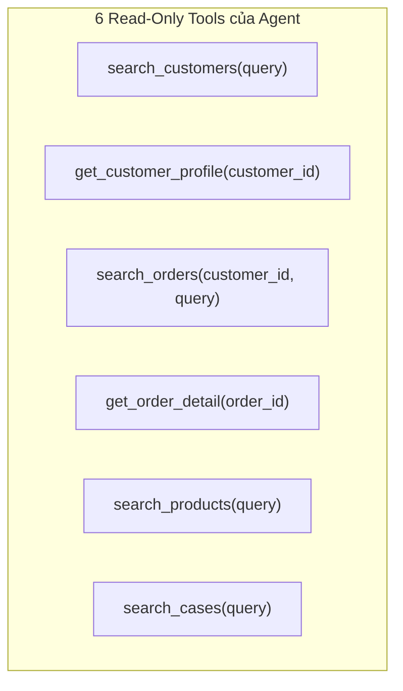

# 06 - AI Architecture & ReAct Engine

> **Status:** Draft  
> **Layer:** Architecture Layer  
> **Scope:** Đặc tả cơ chế ReAct loop, 6 Read-only Tools, Hybrid Search và Grounding  

---

## 1. Hai chế độ vận hành của Copilot

### Chế độ A: Single-Call Assist (Giai đoạn 1)
- Lấy 3 tin nhắn gần nhất $\rightarrow$ BM25 tìm dữ liệu $\rightarrow$ Server tính số liệu $\rightarrow$ Gọi LLM 1 lần với JSON schema $\rightarrow$ Grounding check $\rightarrow$ Trả về 3 gợi ý.

### Chế độ B: Multi-turn ReAct Agent (Giai đoạn 2)
- ReAct loop với `max_turns = 6`.
- Ở mỗi turn: Model sinh ra `thought` và danh sách `tool_calls`.
- Dispatcher thực thi tool, ghi log thời gian thực hiện, token tiêu thụ, rồi phản hồi lại cho model.
- Khi model phát hiện đủ thông tin hoặc đạt turn 6 $\rightarrow$ Dừng và chuyển sang bước soạn gợi ý.

## 2. Đặc tả 6 Read-Only Tools

## 3. Công thức Hybrid Search
$$\text{FinalScore}(doc) = 0.3 \times \text{NormScore}_{\text{BM25}}(doc) + 0.7 \times \text{CosineSim}(\vec{v}_{\text{query}}, \vec{v}_{doc})$$

## 4. Grounding & Anti-Hallucination Guard
- Server phân tích regex để bắt toàn bộ các ID dạng `#\d+`, `prod_\w+`, `case_\w+` trong câu trả lời gợi ý.
- Nếu ID không có trong tập ID thực tế truy vấn được từ DB $\rightarrow$ Báo lỗi hoặc tự động cắt bỏ câu bịa.
