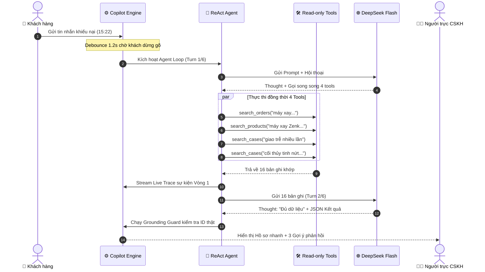
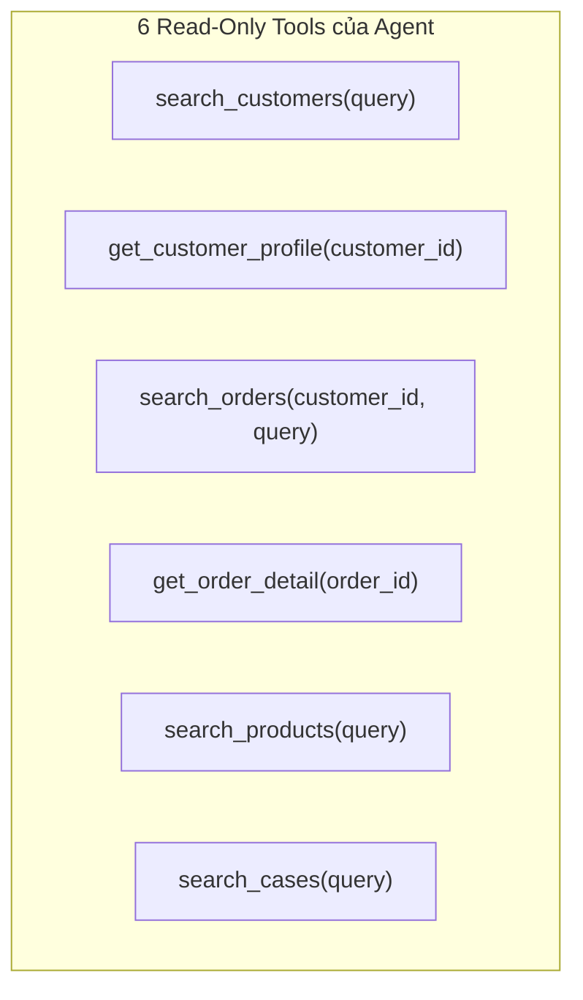

# 06 - AI Architecture & ReAct Engine

> **Status:** Synchronized with Real-app Traces  
> **Layer:** Architecture Layer  
> **Scope:** Đặc tả cơ chế ReAct loop, Parallel Tool Calling, Hybrid Search Dual-Score, Prompt & Output Schema, và Grounding Guard  

---

## 1. Hai chế độ vận hành của Copilot

### Chế độ A: Single-Call Assist (Giai đoạn 1)
- Lấy 3 tin nhắn gần nhất $\rightarrow$ BM25 tìm dữ liệu $\rightarrow$ Server tính số liệu $\rightarrow$ Gọi LLM 1 lần với JSON schema $\rightarrow$ Grounding check $\rightarrow$ Trả về 3 gợi ý.

### Chế độ B: Multi-turn ReAct Agent (Giai đoạn 2 - Chuẩn thực tế)
- **Danh mục Mô hình Hỗ trợ (OpenAI-Compatible Standard):**
  - *Mô hình Gốc (Cloud Hosted):* **DeepSeek v4.1 Flash** (~$0,0016 / lượt chat).
  - *Mô hình Self-Hosted (Colab Pro vLLM - Khuyến nghị học tập):* **Qwen 2.5 7B / 14B Instruct** (Hỗ trợ tiếng Việt xuất sắc, JSON mode và Tool Calling với `--tool-call-parser hermes`, 0 đồng chi phí token).
  - *Mô hình OpenRouter Free:* **Qwen 2.5 7B Instruct Free**, **Gemma 2 9B Free**, **Llama 3.2 3B Free** (Dùng kiểm thử nhẹ không cần bật GPU).
  - *Ngoại tuyến:* **Replay Engine** (Chạy lại trace mẫu không cần API).
- Giới hạn cứng: `max_turns = 6`. Thực tế với truy vấn khiếu nại kép, Agent hoàn tất tối ưu trong **2 vòng (Round 1 & 2)**:
  - **Vòng 1 (1,4s · 1,8k tokens):**
    - `Thought`: *"Tôi sẽ tra đơn máy xay của khách, sản phẩm liên quan, và các case đã xử lý cho cả vấn đề giao trễ lẫn hàng nứt."*
    - **Parallel Tool Calling (Thực thi song song 4 tools):**
      1. `search_orders("máy xay sinh tố giao...")` (1,2s · độ khớp 0,96 · +2 kết quả)
      2. `search_products("máy xay Zenk...")` (1,0s · độ khớp 1,00 · +4 kết quả)
      3. `search_cases("giao trễ nhiều lần")` (1,0s · độ khớp 0,95 · +3 kết quả)
      4. `search_cases("cối thủy tinh nứt khi...")` (2,4s · độ khớp 1,00 · +3 kết quả)
  - **Vòng 2 (483ms · 7k tokens):**
    - `Thought`: *"Đủ dữ liệu, không gọi thêm tool."*
    - `Action`: *"Soạn gợi ý từ 16 bản ghi"* (thời gian soạn 4,1s).
- Tổng thời gian hoàn tất: ~21,0 giây, 3 lần gọi model, 4 lần tra cứu, tổng hợp từ 16 bản ghi thực tế (khi chạy trên Colab A100/L4, thời gian chỉ ~5 - 8 giây).



---

## 2. Đặc tả 6 Read-Only Tools



---

## 3. Thuật toán Hybrid Search & Phân rã Điểm kép (Dual Score)

$$\text{FinalScore}(doc) = 0.3 \times \text{NormScore}_{\text{BM25}}(doc) + 0.7 \times \text{CosineSim}(\vec{v}_{\text{query}}, \vec{v}_{doc})$$

### 3.1. Cơ chế Ghim Thực thể (Pinned Entity)
- Khách hàng đang chat trong phiên (`cus_003 - Nguyễn Văn A`) được tự động đánh dấu `pinned` và luôn xuất hiện trên cùng.

### 3.2. Thanh Phân rã Điểm kép (Dual Score Bar)
Để người trực thấu hiểu lý do kết quả được tìm thấy, UI hiển thị trực quan:
- **BM25 (Từ khóa):** Đo mức độ trùng khớp các từ khóa định danh (`#10032`, `Zenka B600`, `cối thủy tinh`).
- **Semantic (Ý nghĩa):** Đo độ tương đồng ngữ nghĩa từ vector embedding (bắt trúng các từ lóng *"bể"*, *"vỡ tan"*, *"chậm trễ"*).
- Ví dụ đơn hàng `#10032`: $\text{BM25} = 1.00$, $\text{Semantic} = 0.92 \rightarrow \text{Final} = 0.94$.
- Ví dụ đơn hàng `#10018`: $\text{BM25} = 0.29$, $\text{Semantic} = 0.79 \rightarrow \text{Final} = 0.64$.

---

## 4. Định dạng Đầu ra Chuẩn hóa (Agent JSON Output Schema)

```json
{
  "ai_assessment": {
    "title": "Lỗi kép: giao trễ 4 ngày và cối thủy tinh nứt",
    "summary": "Khách đã có 2 đơn giao trễ trên 3 đơn, tỉ lệ đúng hẹn chỉ 33% so với mức 92% của shop, và đây là lần giao trễ thứ hai liên tiếp anh phải chịu. Cối thủy tinh nứt khi nhận là lỗi shop phải xử lý ngay, không để anh phải chờ kiểm tra."
  },
  "context_warning": {
    "warning_title": "Đây là lần giao trễ thứ hai",
    "warning_content": "Anh đã từng khiếu nại vì ấm siêu tốc giao trễ 3 ngày và nhận voucher xin lỗi XINLOI30K. Lặp lại lỗi cũ dễ khiến anh mất niềm tin, nên cần xin lỗi rõ ràng cả hai lỗi ngay từ tin nhắn đầu.",
    "related_tags": ["#10006", "#10032", "hồ sơ khách"]
  },
  "suggestions": [
    {
      "tone": "empathetic",
      "label": "Đồng cảm",
      "content": "Dạ shop thật sự xin lỗi anh, đơn máy xay sinh tố Zenka B600 vừa giao trễ 4 ngày lại còn bị nứt cối thủy tinh, đây là lỗi của shop và shop không đổ lỗi cho bên vận chuyển. Anh giúp shop đừng dùng cối nứt để tránh nguy hiểm nhé, anh gửi shop ảnh cối và tem vận chuyển, shop sẽ gửi máy mới bằng giao hỏa tốc trước và cho người lấy hàng lỗi tận nhà, anh không mất phí gì. Shop xin gửi thêm voucher 100.000đ để bù cho cả hai lỗi này ạ."
    },
    {
      "tone": "concise",
      "label": "Ngắn gọn",
      "content": "Dạ shop xin lỗi anh vì đơn #10032 giao trễ 4 ngày và cối thủy tinh bị nứt khi nhận. Anh gửi shop ảnh cối nứt và tem vận chuyển, shop đổi máy mới trong 7 ngày, giao hỏa tốc miễn phí và lấy hàng lỗi tận nơi. Shop tặng anh voucher 100.000đ, anh muốn trả hàng thì shop hoàn tiền đầy đủ trong 24 giờ ạ."
    },
    {
      "tone": "formal",
      "label": "Trang trọng",
      "content": "Kính chào anh Nguyễn Văn A, shop Nhà Gọn chân thành cáo lỗi cùng anh về sự cố đơn hàng #10032 vừa chậm trễ tiến độ giao vừa phát sinh hư tổn cối xay..."
    }
  ]
}
```

---

## 5. Grounding & Anti-Hallucination Guard
- Server phân tích regex để bắt toàn bộ các ID dạng `#\d+`, `prod_\w+`, `case_\w+` trong câu trả lời gợi ý.
- Nếu ID không có trong tập ID thực tế truy vấn được từ DB $\rightarrow$ Báo lỗi hoặc tự động cắt bỏ câu bịa.
- Kiểm tra tính xác thực của voucher đền bù (voucher phải nằm trong danh mục voucher được phép cấp của shop).
