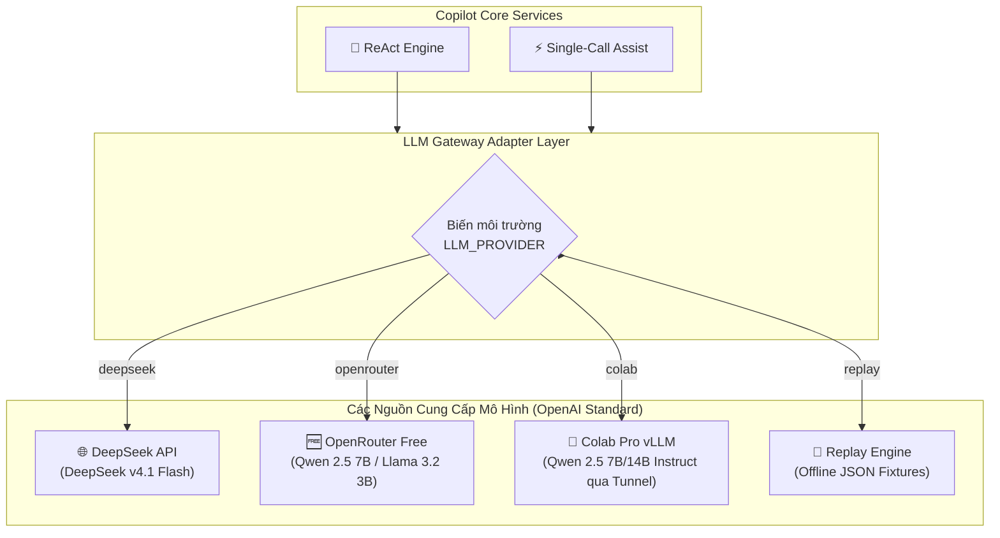

# 08 - Integration Architecture & Protocols

> **Status:** Active (Synchronized with ADR-002)  
> **Layer:** Architecture Layer  
> **Scope:** Đặc tả giao thức tích hợp REST API, SSE streaming, và Multi-Provider LLM Gateway (DeepSeek, OpenRouter Free, Colab Pro vLLM)  

---

## 1. Các Giao thức Tích hợp Chính

### 1.1. REST API Nội bộ
- Chuẩn giao tiếp cho các tác vụ lấy dữ liệu tĩnh, cấu hình khách hàng mẫu, nạp kịch bản khiếu nại và tra cứu chi tiết đơn hàng.
- Format: JSON chuẩn với HTTP status codes rõ ràng (200, 400, 404, 500) tuân thủ RESTful pattern.

### 1.2. Server-Sent Events (SSE) cho Live Agent Trace
- **Endpoint:** `POST /api/v1/agent/run`
- **Header:** `Content-Type: text/event-stream; charset=utf-8`, `Cache-Control: no-cache`, `Connection: keep-alive`
- **Danh sách Event Types chuẩn:**
  - `event: turn_start` $\rightarrow$ Thông báo bắt đầu vòng lặp (`turn: 1/6`, latency, tokens)
  - `event: agent_thought` $\rightarrow$ Nội dung suy nghĩ của Agent trước khi gọi tool
  - `event: tools_executed` $\rightarrow$ Danh sách kết quả gọi tool song song (tên tool, query, độ khớp, thời gian ms)
  - `event: finalize_start` $\rightarrow$ Bắt đầu tổng hợp từ N bản ghi
  - `event: copilot_payload` $\rightarrow$ Toàn bộ dữ liệu phản hồi cuối cùng (Hồ sơ, Cảnh báo, 3 Tone gợi ý, Retrieval breakdown)

---

## 2. Kiến trúc Multi-Provider LLM Gateway (OpenAI-Compatible Standard)

Để đáp ứng nhu cầu tối ưu hóa chi phí (0 đồng) mà vẫn bảo toàn 100% cấu trúc thiết kế, toàn bộ các nhà cung cấp mô hình đều được trừu tượng hóa qua giao thức **OpenAI Chat Completion API (`/v1/chat/completions`)**.



### 2.1. Ma trận Cấu hình Kết nối (`.env`)

```ini
# Lựa chọn Provider: 'colab' | 'openrouter' | 'deepseek' | 'replay'
LLM_PROVIDER=colab

# 1. Profile Google Colab Pro (vLLM self-hosted qua Cloudflare Tunnel)
COLAB_BASE_URL=https://<your-subdomain>.trycloudflare.com/v1
COLAB_API_KEY=colab-local-secret
COLAB_MODEL=Qwen/Qwen2.5-7B-Instruct

# 2. Profile OpenRouter Free
OPENROUTER_BASE_URL=https://openrouter.ai/api/v1
OPENROUTER_API_KEY=sk-or-v1-xxxx
OPENROUTER_MODEL=qwen/qwen-2.5-7b-instruct:free

# 3. Profile DeepSeek (Nguyên bản mẫu)
DEEPSEEK_BASE_URL=https://api.deepseek.com/v1
DEEPSEEK_API_KEY=sk-xxxx
DEEPSEEK_MODEL=deepseek-chat

# 4. Ràng buộc thời gian chờ
LLM_TIMEOUT_SECONDS=45
```

---

## 3. Cơ chế Khả năng Phục hồi & Health-Check (Resilience & Fallback)

Khi sử dụng endpoint Colab Pro hoặc OpenRouter Free:
1. **Colab Heartbeat Check**:
   - Trước khi khởi động phiên ReAct, hệ thống thực hiện 1 cuộc gọi ping nhẹ: `GET {COLAB_BASE_URL}/models` với timeout 1.5 giây.
   - Nếu Colab bị tắt máy hoặc URL tunnel hết hạn $\rightarrow$ hệ thống kích hoạt fallback an toàn sang `OPENROUTER` hoặc `REPLAY` mode, đồng thời hiển thị cảnh báo rõ ràng trên giao diện.
2. **Rate Limit Handling trên OpenRouter Free**:
   - Khi gặp mã lỗi HTTP `429 Too Many Requests`, hệ thống tự động bắt lỗi và thông báo người trực chuyển sang chế độ `Replay Mode` hoặc bật GPU Colab để tiếp tục kiểm thử.

---

## 4. Đặc tả Tích hợp Vector Embeddings

- **Phương án A (Offline Local Embeddings - Khuyến nghị):**
  - Chạy thư viện `sentence-transformers` trên CPU máy cục bộ với model nhỏ: `bkai-foundation-models/vietnamese-bi-encoder` (~120MB).
  - Tốc độ: ~15ms / văn bản, 100% offline, miễn phí vĩnh viễn.
- **Phương án B (Remote Embeddings):**
  - Gọi endpoint nhúng vector của chính vLLM server trên Colab (`POST /v1/embeddings`).
