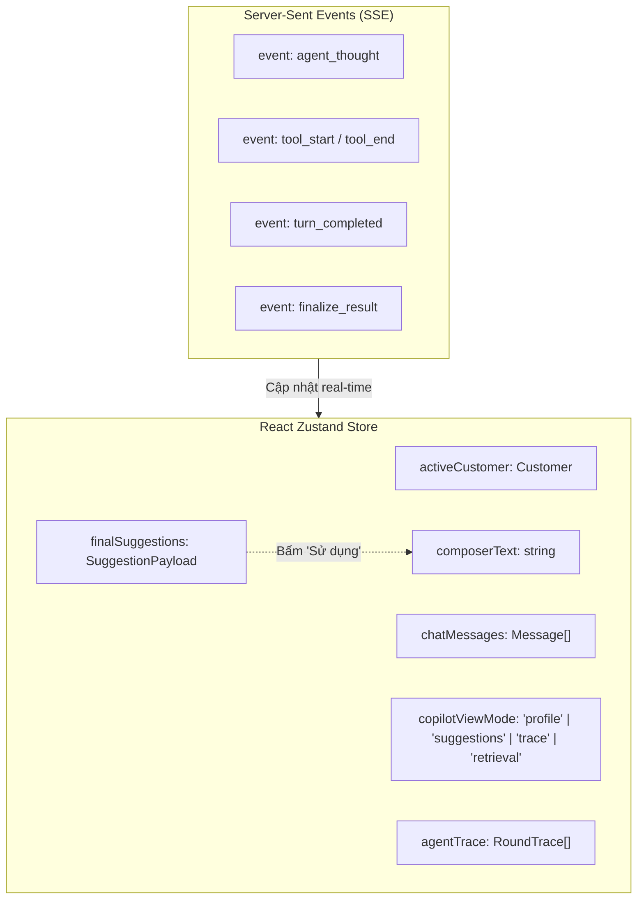

# 11 - Frontend System Design

> **Status:** Synchronized with Real App UI  
> **Layer:** Architecture Layer  
> **Scope:** Thiết kế hệ thống Frontend, kiến trúc Workspace Shell 3 Cột và 4 View của Cột Copilot  

---

## 1. Kiến trúc Bố cục Workspace Shell

Toàn bộ ứng dụng được bọc trong một Workspace Shell gồm:
- **Thanh trạng thái trên cùng (Top Metric & Cost Bar):** Hiển thị model đang chạy (`DeepSeek v4.1 Flash`), tổng thời gian (`21,0 giây`), số lần gọi model (`3 lần`), số lần tra cứu (`4 lần`), và chi phí API (`từ $0,0016 một lượt, 1.000 lượt chat từ $1,6`).
- **3 Cột làm việc song song (Dual/Split Workspace):**

```
┌────────────────────────────────────────────────────────────────────────────────────────┐
│ TOP BANNER: DeepSeek v4.1 Flash · 21.0s · 3 model calls · 4 lookups · $0.0016/run     │
├───────────────────────┬───────────────────────────┬────────────────────────────────────┤
│ CỘT 1: KHÁCH HÀNG     │ CỘT 2: NGƯỜI TRỰC         │ CỘT 3: COPILOT PANEL (4 CHẾ ĐỘ XEM)│
│ - Selector: cus_003   │ - Header: Info khách hàng │ [1. Hồ sơ nhanh]                   │
│ - Kịch bản mẫu khiếu  │ - Khung chat hai chiều    │ [2. Gợi ý trả lời] (3 mẫu)         │
│   nại (máy xay nứt)   │ - Ô soạn thảo phản hồi    │ [3. Agent đang làm gì] (Live Trace)│
│ - Chat input & Send   │ - Nút "Gửi" tin nhắn      │ [4. Tìm kiếm] (Hybrid Breakdown)   │
└───────────────────────┴───────────────────────────┴────────────────────────────────────┘
```

---

## 2. Đặc tả Chi tiết 4 Chế độ Xem của Cột Copilot

Cột Copilot sở hữu menu điều hướng bên trái dạng thẻ dọc cho phép chuyển đổi tức thì giữa 4 góc nhìn:

### View 1: Hồ sơ nhanh (Customer Profile & AI Assessment)
- **Customer Card Header:** Avatar, Tên (`Nguyễn Văn A`), Hạng (`Silver`), Địa phương (`Đà Nẵng`), Thời gian gắn bó (`khách từ 08/2025`).
- **Thẻ Nhận định AI:** Icon sparkles, Tiêu đề tình thế (*"Lỗi kép: giao trễ 4 ngày và cối thủy tinh nứt"*), Đoạn phân tích bối cảnh và khuyến nghị ưu tiên xử lý.
- **4 Chỉ số Khách hàng (kèm Shop Benchmark):**
  - `CLV lịch sử`: 2,52 tr đ (kèm nhãn `↘ Dưới trung vị 3,93tr`).
  - `AOV`: 840 k đ (kèm nhãn `↘ Thấp hơn TB shop 46%`).
  - `Tần suất mua`: 3 đơn / 13 tháng (kèm nhãn `🔄 Đều, ~2 tháng một đơn`).
  - `Giao đúng hẹn`: 33% (kèm nhãn cảnh báo `⚠ Shop đạt 92%`).
- **Thẻ "CẦN LƯU Ý" (AI Context Warning):** Cảnh báo lỗi giao trễ lặp lại lần 2 (từng khiếu nại đơn `#10006` nhận voucher `XINLOI30K`), gắn tag clickable `#10006`, `#10032`, `hồ sơ khách`.
- **Biểu đồ "3 ĐƠN GẦN NHẤT":** Bar chart dòng thời gian (05 → 09/2026), phân loại màu: Đúng hẹn (Cyan), Trễ hẹn (Yellow), Đơn đang khiếu nại (Yellow striped + Red border).

### View 2: Gợi ý trả lời (Response Suggestions)
- **Header:** Icon tin nhắn, Tiêu đề `Gợi ý trả lời`, Badge `3 mẫu`.
- **3 Thẻ phản hồi theo Tone:**
  - *Empathetic (Đồng cảm):* Icon trái tim, nhận lỗi của shop, không đổ lỗi bên vận chuyển, cảnh báo không dùng cối nứt, đổi mới hỏa tốc tận nhà, voucher 100.000đ.
  - *Concise (Ngắn gọn):* Icon tia sét, nêu thẳng mã đơn `#10032`, thời hạn 7 ngày, voucher 100k, tùy chọn hoàn tiền 24h.
  - *Formal (Trang trọng):* Văn phong doanh nghiệp chuẩn mực.
- **Tương tác cốt lõi:**
  - Nút `Copy` (sao chép vào clipboard).
  - Nút `↩ Sử dụng` (màu xanh lá nổi bật #84cc16): Đẩy nội dung trực tiếp vào ô soạn thảo ở Cột Người trực và focus con trỏ chuột.

### View 3: Agent đang làm gì (Live Execution Trace)
- **Header:** Icon branch, trạng thái *"Agent đang soạn gợi ý..."*, đồng hồ đo thời gian (ví dụ: `14 giây`).
- **Tiến trình từng vòng (Turn Stepper):**
  - **Vòng 1/6 (1,4s · 1,8k token):** Hiển thị Thought + 4 thẻ Parallel Tool calls (mỗi thẻ có query, thời gian chạy, tên kết quả hàng đầu, thanh tiến trình score và badge kết quả phụ).
  - **Vòng 2/6 (483ms · 7k token):** Hiển thị Thought "Đủ dữ liệu, không gọi thêm tool" + Thẻ Action "Soạn gợi ý từ 16 bản ghi" (spinner `C`, 4,1s).

### View 4: Tìm kiếm (Hybrid Retrieval Breakdown)
- **Header:** Icon target, `Retrieval hybrid`, Badge `12 hits · 1 pinned`, toggle thu gọn.
- **Công thức tính điểm:** $\text{score} = 0,3 \times \text{BM25 (từ khóa)} + 0,7 \times \text{semantic (ý nghĩa)}$ với chú giải màu phân tách.
- **Danh mục kết quả có cấu trúc:**
  - `Customers (1)`: Thực thể `cus_003 - Nguyễn Văn A` có badge `pinned`.
  - `Orders (3)`: `#10032` (score 0.94), `#10018` (score 0.64), `#10006` (score 0.46) kèm Dual Score Bar.
  - `Products (5)`: `prd_001` (score 1.00), `prd_010` (score 0.49), `prd_016` (score 0.47) kèm Dual Score Bar.

---

## 3. Kiến trúc Quản lý Trạng thái Frontend (State Architecture)


