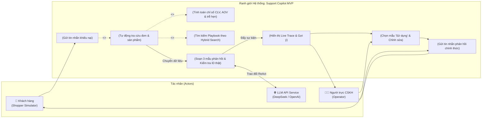
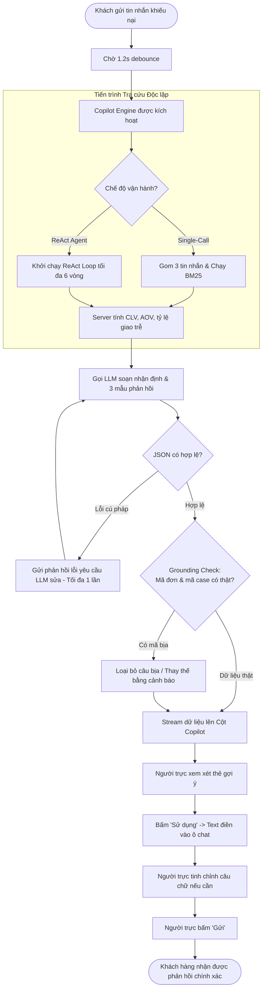

# Product Requirements Document (PRD): Support Copilot · Release 1 (MVP)

> **Tầng tài liệu:** Implementation Layer  
> **Release:** Release 1 (MVP / PoC)  
> **Phiên bản:** 1.0  
> **Ngày phê duyệt:** 2026-10-12  
> **Tác giả:** Senior IT Business Analyst & Product Owner  
> **Trạng thái:** Approved  
> **Requirements Quality Score:** 96 / 100  

---

## 1. Mục tiêu Đợt Phát hành & Bối cảnh Nghiệp vụ (Release Goals & Business Context)

### 1.1. Mục tiêu Đợt phát hành
- **Tham chiếu Business Layer:** Triển khai đúng các định hướng tại [docs/business/brd.md](../../business/brd.md) và mốc Horizon 1 trong [docs/business/roadmap.md](../../business/roadmap.md).
- **Bài toán giải quyết:** Xây dựng giải pháp AI Copilot CSKH thực chiến đầu tiên cho ngành bán lẻ thiết bị, đảm bảo:
  1. Hỗ trợ người trực xử lý các tình huống khiếu nại phức tạp (lỗi kép: giao trễ + hỏng hóc).
  2. Triệt tiêu 100% rủi ro AI phát ngôn sai hoặc tự ý bồi thường sai chính sách thông qua cơ chế Human-in-the-Loop và Grounding Guard.
  3. Rút ngắn thời gian xử lý khiếu nại từ 5 phút xuống dưới 90 giây.

### 1.2. Chỉ số Thành công cho Release 1 (Success Metrics & KPIs)
| Chỉ số (KPI) | Hiện trạng (Manual) | Mục tiêu Release 1 (Copilot MVP) | Phương pháp Đo lường |
| :--- | :--- | :--- | :--- |
| **Thời gian phản hồi đầu tiên (FRT)** | 3 - 5 phút | $\le$ 30 giây (kể cả thời gian Agent tra cứu) | Timestamp tin nhắn khách đến tin nhắn shop gửi |
| **Độ chính xác dữ liệu (Data Precision)** | Phụ thuộc trí nhớ người trực | **100% đúng mã đơn & giá trị CLV/AOV** | Code đối soát tự động (Grounding Guard) |
| **Tỷ lệ áp dụng câu gợi ý** | 0% | $\ge$ 75% phiên chat dùng 1 trong 3 mẫu | Log sự kiện bấm nút "Sử dụng" |
| **Số vòng suy luận tối đa của Agent** | N/A | Không vượt quá 6 vòng lặp (`max_turns <= 6`) | Log bộ đếm turns trong `AgentEngine` |

---

## 2. Đối tượng Sử dụng trong Release 1 (User Personas)

1. **Nhân viên trực CSKH (Support Operator - Primary User):**  
   Cần một màn hình làm việc thông minh, hiển thị ngay lịch sử giao dịch và câu trả lời gợi ý khi khách than phiền, cho phép bấm 1 nút để đưa vào ô chat và chỉnh sửa nhanh.
2. **Khách hàng giả lập (Shopper Simulator - Testing Actor):**  
   Đóng vai trò người mua hàng để kiểm thử các kịch bản thực tế (chọn khách hàng mẫu, gửi tin nhắn phàn nàn có dấu, không dấu, hoặc dùng từ lóng).

---

## 3. Ranh giới Hệ thống & Sơ đồ Phạm vi (Scope & System Boundary)

### 3.1. Sơ đồ Use Case Ranh giới Hệ thống (Use Case Diagram)

### 3.2. Phạm vi Chi tiết (Scope Definition)
- **In-Scope (Cam kết bàn giao trong Release 1):**
  - Quản lý và tra cứu 4 tệp dữ liệu mẫu: `customers.json`, `orders.json`, `products.json`, `complaint-cases.json`.
  - Bộ công cụ tìm kiếm kết hợp Hybrid Search (30% BM25 từ khóa + 70% Semantic Vector Embedding trên SQLite).
  - Hai chế độ hỗ trợ: Single-Call Assist và Multi-turn ReAct Agent với 6 Read-only Tools.
  - Bộ tính toán chỉ số thống kê khách hàng hoàn toàn xác định (Deterministic Stats Calculator).
  - Bộ lọc Grounding Guard triệt tiêu ảo giác về mã đơn hàng và mã sản phẩm.
  - Giao diện 3 cột song song (Khách hàng, Người trực, Cột Copilot) kèm chế độ Replay Mode.
- **Out-of-Scope (Tuyệt đối không làm trong Release 1):**
  - Không cho phép Agent gửi tin nhắn trực tiếp ra bên ngoài mà không có người trực duyệt.
  - Không kết nối thanh toán ngân hàng hoặc cổng vận chuyển thực tế bên ngoài.

---

## 4. Quy trình Nghiệp vụ Cốt lõi (Core Business Workflows)

### 4.1. Sơ đồ Luồng Nghiệp vụ Hoàn chỉnh (End-to-End Process Flow)

---

## 5. Yêu cầu Chức năng & Quy tắc Nghiệp vụ (FR & Business Rules)

| Mã FR | Tên chức năng | Mô tả nghiệp vụ | Quy tắc nghiệp vụ (Business Rules) | Mức ưu tiên |
| :---: | :--- | :--- | :--- | :---: |
| **FR-01** | **Khung Chat Simulator & Kịch bản mẫu** | Chọn khách hàng mẫu và nạp sẵn kịch bản khiếu nại | Hỗ trợ chọn `cus_003 - Nguyễn Văn A`, nạp kịch bản "máy xay bể cối + giao trễ" để kiểm thử nhanh. | **P0 (Must)** |
| **FR-02** | **Kích hoạt Trì hoãn (Debounce)** | Tự động kích hoạt Copilot khi khách dừng gõ | **Quy tắc:** Đếm ngược đúng **1.2 giây** kể từ tin nhắn cuối cùng của khách mới bắt đầu gọi Agent. | **P0 (Must)** |
| **FR-03** | **Hồ sơ Nhanh & Nhận định AI kèm Shop Benchmark** | Hiển thị thẻ nhận định AI và 4 chỉ số tài chính đối chiếu mức chung shop | **Quy tắc:** CLV (2,52tr vs trung vị shop 3,93tr), AOV (840k vs TB shop -46%), Tần suất (3 đơn/13 tháng), Đúng hẹn (33% vs shop 92%) do Server tính 100%. | **P0 (Must)** |
| **FR-04** | **Thẻ Cảnh báo Tiền lệ (Context Warning)** | Phát hiện sự cố lặp lại từ lịch sử khiếu nại cũ | **Quy tắc:** Phát hiện khách từng nhận voucher `XINLOI30K` vì đơn ấm siêu tốc `#10006` trễ 3 ngày; gắn tag `#10006`, `#10032`, `hồ sơ khách`. | **P0 (Must)** |
| **FR-05** | **Biểu đồ Cột 3 Đơn Gần Nhất** | Biểu diễn timeline đơn hàng kèm trạng thái trực quan | **Quy tắc:** Phân biệt 3 màu: Cyan (đúng hẹn), Vàng (trễ hẹn), Vàng sọc viền đỏ (đang khiếu nại đơn `#10032`). | **P0 (Must)** |
| **FR-06** | **3 Mẫu Phản hồi & Thao tác '↩ Sử dụng'** | Cung cấp 3 phương án trả lời theo 3 tone | **Quy tắc:** Đủ 3 tone (*Empathetic*, *Concise*, *Formal*). Bấm nút `↩ Sử dụng` thì text điền vào ô chat và focus con trỏ, **tuyệt đối không tự ý gửi**. | **P0 (Must)** |
| **FR-07** | **Live Trace Streaming "Agent đang làm gì"** | Hiển thị tiến trình suy luận và gọi công cụ theo thời gian thực | **Quy tắc:** Hiển thị từng vòng (Round 1 & 2), Thought, gọi song song 4 tools kèm thời gian thực thi, thanh điểm độ khớp và badge kết quả phụ. | **P0 (Must)** |
| **FR-08** | **Minh bạch Tra cứu "Tìm kiếm" (Hybrid Breakdown)** | Hiển thị chi tiết cơ chế ghép điểm BM25 và Semantic | **Quy tắc:** Công thức $\text{score} = 0.3 \times \text{BM25} + 0.7 \times \text{semantic}$. Ghim khách hàng (`pinned`). Hiển thị thanh điểm kép (Dual Score Bar). | **P0 (Must)** |
| **FR-09** | **Thanh Giám sát Hiệu năng & Chi phí API** | Theo dõi model, độ trễ và chi phí trên top banner | **Quy tắc:** Hiển thị tên model DeepSeek Flash, thời gian chạy (~21s), số lượt gọi model, số lượt tra cứu và chi phí ($0,0016 / lượt chat). | **P0 (Must)** |
| **FR-10** | **Grounding Guard & Anti-Hallucination** | Triệt tiêu ảo giác về mã đơn, mã sản phẩm và chính sách | **Quy tắc:** Bắt buộc đối soát 100% ID với SQLite. Nếu model sinh mã không có thật, tự động gạch bỏ câu trả lời bịa đặt. | **P0 (Must)** |

---

## 6. Rào chắn Kiến trúc cho Release 1 (Architecture Guardrails)

> ⛔ **Bắt buộc tuân thủ Single Source of Truth:** Đội ngũ phát triển và AI Coding Agent khi lập trình **bắt buộc** phải tuân theo các tài liệu kiến trúc sau:

1. **Data Invariants:** Tuân thủ 100% cấu trúc 4 file JSON và bảng SQLite định nghĩa tại [docs/architecture/05-data-architecture.md](../../architecture/05-data-architecture.md). Tuyệt đối không thay đổi kiểu dữ liệu cột.
2. **AI & ReAct Engine:** Tuân thủ cơ chế ReAct loop và 6 tools schema tại [docs/architecture/06-ai-architecture.md](../../architecture/06-ai-architecture.md).
3. **Security & Human-in-the-Loop:** Tuyệt đối không cấp quyền ghi cho Agent hoặc quyền gửi tin nhắn tự động theo [docs/architecture/07-security-architecture.md](../../architecture/07-security-architecture.md).
4. **Code Standards:** Không dùng LangChain hay LlamaIndex; tuân thủ triết lý Clean Architecture tại [docs/architecture/09-design-principles.md](../../architecture/09-design-principles.md).
5. **Design Tokens:** Mọi thành phần giao diện phải sử dụng đúng hệ thống Design Tokens và chuẩn WCAG 2.2 AA tại [docs/architecture/12-design-system.md](../../architecture/12-design-system.md) và [docs/architecture/14-design-language.md](../../architecture/14-design-language.md).

---

## 7. Quản lý Câu hỏi Mở (Open Questions Log)

| Mã OQ | Vấn đề nghiệp vụ cần làm rõ | Bên phụ trách | Trạng thái | Quyết định đã chốt |
| :---: | :--- | :--- | :---: | :--- |
| `OQ-01` | Khi khách than phiền nhiều câu liên tiếp, khi nào Copilot bắt đầu tra cứu? | Tech Lead / BA | `[x] Resolved` | Sử dụng cơ chế Debounce 1.2s kể từ tin nhắn cuối cùng để tối ưu chi phí token và tránh gọi API phân mảnh. |
| `OQ-02` | Trường hợp khách khiếu nại "lỗi kép" (vừa giao trễ vừa vỡ hàng), chính sách bồi thường ưu tiên là gì? | CSKH Lead | `[x] Resolved` | Nhận lỗi ngay, đổi mới hỏa tốc 2 chiều trong 7 ngày, tặng voucher 100.000đ để bù đắp sự bất tiện do giao trễ. |
| `OQ-03` | Người trực có bắt buộc phải dùng nguyên văn câu gợi ý không? | Product Owner | `[x] Resolved` | Không bắt buộc. Nút "Sử dụng" chỉ điền văn bản vào ô chat để người trực đọc, chỉnh sửa câu chữ tùy ý trước khi bấm "Gửi". |

---

## 8. Kế hoạch Bàn giao & Bước Tiếp theo

1. **Bàn giao Kỹ thuật (Technical Design):** Hoàn thiện các sequence diagram và model schema trong [docs/implementation/release-1/technical-design.md](./technical-design.md).
2. **Bàn giao Backlog & Stories:** Bóc tách các User Story chi tiết (US-001 đến US-008) kèm Acceptance Criteria chuẩn Given-When-Then tại [docs/implementation/release-1/backlog/copilot-story-index.md](./backlog/copilot-story-index.md).
