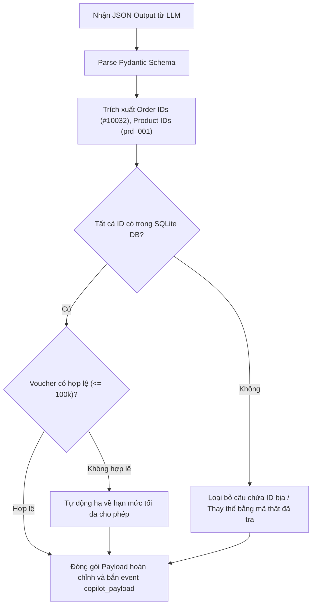

# Technical Design — Release 1: MVP Support Copilot

> **Status:** Active (Synchronized with Real-app Architecture)  
> **Release:** Release 1 (MVP)  
> **Layer:** Implementation Layer  

---

## 1. Sequence Diagram: Luồng ReAct Agent Streaming (SSE)

```mermaid
sequenceDiagram
    autonumber
    actor Customer as 👤 Khách hàng
    participant Frontend as 🖥️ React Workspace
    participant FastAPI as 🚀 FastAPI Server
    participant Agent as 🤖 ReAct Engine
    participant Tools as 🛠️ Read-Only Tools
    participant LLM as 🌐 DeepSeek v4.1 Flash
    actor Operator as 👨‍💼 Người trực CSKH

    Customer->>Frontend: Gửi tin nhắn khiếu nại (15:22)
    Note over Frontend: Debounce 1.2s trước khi gửi request
    Frontend->>FastAPI: POST /api/v1/agent/run (Stream SSE)
    FastAPI->>Agent: Khởi tạo ReAct Session (max_turns=6)
    
    rect rgb(20, 25, 35)
        Note over Agent,LLM: Turn 1/6 (1.4s · 1.8k token)
        Agent->>LLM: Prompt + Lịch sử + Tool Schemas
        LLM-->>Agent: Thought + Gọi đồng thời 4 tools
        Agent-->>FastAPI: SSE event: turn_thought
        FastAPI-->>Frontend: Render "Vòng 1/6" & Thought
        par Parallel Tool Execution
            Agent->>Tools: search_orders("máy xay sinh tố...") (1.2s)
            Agent->>Tools: search_products("máy xay Zenk...") (1.0s)
            Agent->>Tools: search_cases("giao trễ nhiều lần") (1.0s)
            Agent->>Tools: search_cases("cối thủy tinh nứt...") (2.4s)
        end
        Tools-->>Agent: Trả về 16 bản ghi kết quả
        Agent-->>FastAPI: SSE event: tool_batch_result
        FastAPI-->>Frontend: Hiển thị 4 thẻ tools kèm thanh điểm & latency
    end

    rect rgb(20, 25, 35)
        Note over Agent,LLM: Turn 2/6 (483ms · 7k token)
        Agent->>LLM: Gửi 16 bản ghi kết quả
        LLM-->>Agent: Thought: "Đủ dữ liệu" + Soạn gợi ý (4.1s)
        Agent-->>FastAPI: SSE event: finalize_start
        FastAPI-->>Frontend: Render icon bút xanh "Soạn gợi ý từ 16 bản ghi"
    end

    Agent->>FastAPI: Output JSON thô
    FastAPI->>FastAPI: Chạy Grounding Guard kiểm tra ID thật
    FastAPI-->>Frontend: SSE event: copilot_result_ready (Payload hoàn chỉnh)
    Frontend-->>Operator: Hiển thị Hồ sơ nhanh, Cảnh báo tiền lệ & 3 Card gợi ý
    Operator->>Frontend: Bấm nút "↩ Sử dụng" -> Text điền vào ô chat -> Duyệt -> Bấm "Gửi"
    Frontend->>Customer: Gửi tin nhắn phản hồi chính thức
```



---

## 2. Đặc tả Chi tiết Các Sự kiện SSE (Server-Sent Events)

Hệ thống giao tiếp qua endpoint `POST /api/v1/agent/run`:

```json
// Event 1: Bắt đầu vòng suy luận
event: turn_start
data: {"turn": 1, "max_turns": 6, "tokens": 1820, "latency_ms": 1400}

// Event 2: Suy nghĩ của Agent
event: agent_thought
data: {"thought": "Tôi sẽ tra đơn máy xay của khách, sản phẩm liên quan, và các case đã xử lý cho cả vấn đề giao trễ lẫn hàng nứt."}

// Event 3: Kết quả gọi công cụ song song
event: tools_executed
data: [
  {"tool": "search_orders", "query": "máy xay sinh tố giao...", "latency_ms": 1200, "top_match": "Máy xay Zenka, Cáp...", "score": 0.96, "extra_count": 2},
  {"tool": "search_products", "query": "máy xay Zenk...", "latency_ms": 1000, "top_match": "Máy xay sinh tố Zenk...", "score": 1.00, "extra_count": 4},
  {"tool": "search_cases", "query": "giao trễ nhiều lần", "latency_ms": 1000, "top_match": "Hàng vừa giao trễ vừ...", "score": 0.95, "extra_count": 3},
  {"tool": "search_cases", "query": "cối thủy tinh nứt khi...", "latency_ms": 2400, "top_match": "Cối thủy tinh máy xa...", "score": 1.00, "extra_count": 3}
]

// Event 4: Hoàn tất tổng hợp và gửi Payload cuối cùng
event: copilot_payload
data: {
  "execution_metrics": {
    "model": "DeepSeek v4.1 Flash",
    "total_latency_seconds": 21.0,
    "model_calls": 3,
    "lookups": 4,
    "cost_usd": 0.0016
  },
  "customer_profile": {
    "id": "cus_003",
    "name": "Nguyễn Văn A",
    "tier": "Silver",
    "location": "Đà Nẵng",
    "member_since": "08/2025",
    "stats": {"clv": 2520000, "aov": 840000, "frequency_orders": 3, "frequency_months": 13, "on_time_rate": 0.33},
    "shop_benchmark": {"clv_median": 3930000, "aov_mean": 1555000, "on_time_rate": 0.92}
  },
  "ai_assessment": {
    "title": "Lỗi kép: giao trễ 4 ngày và cối thủy tinh nứt",
    "content": "Khách đã có 2 đơn giao trễ trên 3 đơn, tỉ lệ đúng hẹn chỉ 33% so với mức 92% của shop..."
  },
  "context_warning": {
    "title": "Đây là lần giao trễ thứ hai",
    "content": "Anh đã từng khiếu nại vì ấm siêu tốc giao trễ 3 ngày và nhận voucher xin lỗi XINLOI30K...",
    "tags": ["#10006", "#10032", "hồ sơ khách"]
  },
  "recent_orders": [
    {"order_id": "#10006", "date": "09/05", "product": "Ấm Mavio K17", "amount": 420000, "status": "late", "delay_days": 3},
    {"order_id": "#10018", "date": "18/07", "product": "Máy sấy Nordi", "amount": 660000, "status": "on_time", "delay_days": 0},
    {"order_id": "#10032", "date": "27/09", "product": "Máy xay Zenka", "amount": 1440000, "status": "complaining", "delay_days": 4}
  ],
  "suggestions": [
    {"tone": "empathetic", "label": "Đồng cảm", "text": "Dạ shop thật sự xin lỗi anh..."},
    {"tone": "concise", "label": "Ngắn gọn", "text": "Dạ shop xin lỗi anh vì đơn #10032..."},
    {"tone": "formal", "label": "Trang trọng", "text": "Kính chào anh Nguyễn Văn A..."}
  ],
  "retrieval_breakdown": {
    "formula": "score = 0,3 * BM25 + 0,7 * semantic",
    "hits_count": 12,
    "pinned_count": 1,
    "customers": [{"code": "cus_003", "name": "Nguyễn Văn A", "pinned": true}],
    "orders": [
      {"code": "ord_10032", "name": "Máy xay sinh tố Zenka B600 cối t...", "bm25": 1.00, "semantic": 0.92, "final_score": 0.94},
      {"code": "ord_10018", "name": "Máy sấy tóc ion Nordi HD18 1800W", "bm25": 0.29, "semantic": 0.79, "final_score": 0.64},
      {"code": "ord_10006", "name": "Ấm siêu tốc inox Mavio K17 1.7L", "bm25": 0.23, "semantic": 0.56, "final_score": 0.46}
    ],
    "products": [
      {"code": "prd_001", "name": "Máy xay sinh tố Zenka B600 cối t...", "bm25": 1.00, "semantic": 1.00, "final_score": 1.00},
      {"code": "prd_010", "name": "Hộp cơm giữ nhiệt Coral Home 3 ...", "bm25": 0.16, "semantic": 0.64, "final_score": 0.49},
      {"code": "prd_016", "name": "Cây lau nhà xoay 360 độ kèm th...", "bm25": 0.07, "semantic": 0.65, "final_score": 0.47}
    ]
  }
}
```

---

## 3. Activity Swimlane: Xử lý Grounding Guard


