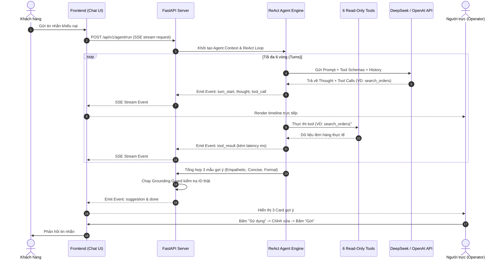
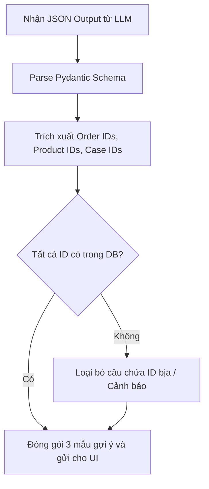

# Technical Design — Release 1: MVP Support Copilot

> **Status:** Draft  
> **Release:** Release 1  

---

## 1. Sequence Diagram: Luồng ReAct Agent Streaming (SSE)

## 2. Activity Swimlane: Xử lý Grounding Guard

